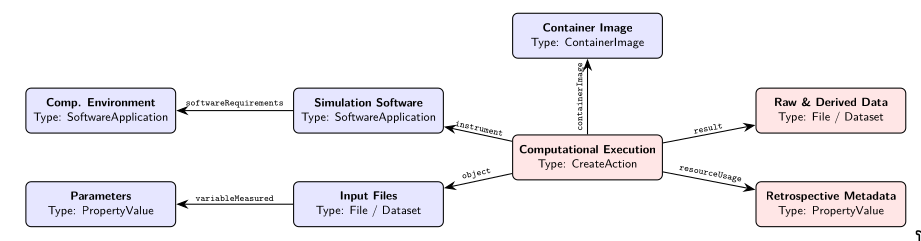

## Overview

* **Phase-Field Data**
* **AI Ready Data**
* **A 5-Level Maturity Ladder**
* **Reaching Level 3 (RO-Crate & WRROC)**
* **Defining Level 4 (MatCore-PF)**
* **MatSci-SAM Trial**

::: {.notes}
* Frame the talk as an interactive 20-minute overview designed to spark open discussion.
* Emphasize that this combines two closely linked efforts: the MaRDA Phase-Field Schema Working Group paper (focused on practical RO-Crate packaging) and the NSF MatCore-PF standard (focused on minimum domain metadata, currently undergoing revision based on community feedback).
:::

---

## Why Phase Field Lags in FAIR Data {.smaller}

:::: {.columns}

::: {.column width="45%"}

**Atomistic & DFT Succeeded:**

* Consolidated around a few standard codes (**LAMMPS**, **GROMACS**, **VASP**)
  and community repositories (**NOMAD**, **Materials Project**, **OQMD**,
  **OPTIMADE**).

**Phase-Field Constraints:**

1. **Input Diversity:** CALPHAD databases, experiments, and atomistic inputs
   making it difficult to record provenance.
2. **Large Binary Data Volumes:** Large VTK / NetCDF / XDMF files strip semantic context.
3. **Custom Codes** with different physics
4. **Absence of Central Infrastructure**

:::

::: {.column width="55%"}
<!--  -->



<!-- <div style="font-size: 0.55em; text-align: center; margin-top: 6px; line-height: 1.2; color: #666;"> -->
<!-- <b>Unified Visual Grammar:</b> <b>Blue/Teal</b> = Prospective inputs & model setup; <b>Amber hexagons</b> = Execution & post-processing; <b>Red cylinders</b> = Retrospective data & repository curation. -->
<!-- </div> -->
 
<div style="font-size: 0.55em; text-align: center; margin-top: 8px; line-height: 1.2; color: #666;">
<b>Phase-Field Workflow</b>
</div>
:::

::::

::: {.notes}
* Contrast MD (where a single force field + atomic coordinates define the run) with phase field (where custom PDEs, non-dimensionalizations, and CALPHAD couplings vary wildly).
* Because raw field outputs are huge, researchers typically only share post-processed curves (like Avrami solid fraction on PFHub), discarding the raw field state needed for secondary analysis or ML surrogate training.
:::

---

## Why Schemas Matter in the Era of AI {.smaller}

:::: {.columns}

::: {.column width="55%"}

*"If LLMs can read arbitrary code and files, why bother with schemas and controlled vocabularies?"*

* Coding agents can infer and format metadata automatically from scripts and build files.
* No LLM can inspect a raw binary `.vtk` array and recover unrecorded physical units, boundary conditions, CALPHAD database versions.
* Symbols like $W$, $M$, $\kappa$, and $\epsilon$ carry conflicting meanings and units.
* Trustworthy AI requires unassailable data; guessing missing context risks corrupting ML surrogates.

:::

::: {.column width="45%"}



:::

::::

<div style="font-size: 0.55em; margin-top: 15px; padding: 10px; border-left: 4px solid #268bd2; background: rgba(38, 139, 210, 0.08);">
<em>"The key for successful digital metrology and data science is well prepared metadata... Rich metadata captures the proper context of data acquisition and by maintaining detail data provenance it is traceable to its origin and is helpful for the AI models to understand any measurement shifts or any systematic errors."</em>[cite: 2]<br>
— <a href="https://inet.nist.gov/lp/adlp/rdco/super-intelligence-si-ready-data-aiml-ready-data?check_logged_in=1" style="color: #666; text-decoration: none;">NIST Super Intelligence (SI) Ready Data Guidelines</a>
</div>

::: {.notes}
* Be candid here: if a schema requires researchers to manually fill out giant web forms, it will fail, and AI *should* kill that workflow.
* However, when training ML surrogates (like Fourier Neural Operators for AM) or letting agentic AI tools orchestrate simulations, probabilistic guessing over unannotated folders leads to silent unit and physics errors.
* Controlled vocabularies + normative units turn an error-prone reverse-engineering guess into a fast, deterministic validation check.
:::

---

## Incremental Progress: 5-Level FAIR Maturity

* **Level 1:** Data and code described in prose, available only "upon
  reasonable request" (PDF).
* **Level 2:** Code and data open and licensed, but how code was used is
  unknown (Git repository) *(current baseline)*.
* **Level 3:** Inputs, provenance, and outputs packaged as a
  machine-actionable graph (`RO-Crate` + `WRROC`).
* **Level 4:** Community-agreed mandatory domain fields and controlled
  vocabularies (`MatCore-PF`).
* **Level 5:** CI/CD pipelines and repositories automatically validate
  metadata and physical consistency.

::: {.notes}
* Credit Zach Trautt for framing this 5-level maturity staircase.
* You can use either the D2 version above or Zach's compiled TikZ staircase (`images/5-level-maturity-phase-field.svg`).
:::

---

## Six Metadata Categories {.smaller}

:::: {.columns}

::: {.column width="42%"}

* **Prospective:** Knowable *before* execution—problem specification, numerical scheme, software environment. Authored or inferred once and reused.
* **Retrospective:** Capturable only *during/after* execution—timestamps, wall time, memory usage, output file manifests, and checksums.

**The Critical Gap:**

* Generic standards (`Schema.org`, `DataCite`, `CodeMeta`) already handle **M3–M6** well.
* **M1 (Problem Specification)** and **M2 (Numerical Solution)** have **Low** maturity—no cross-code standard exists for PDE formulations and discretizations.

:::

::: {.column width="58%"}

::: {style="font-size: 0.8em;"}
| Category | Representative Standards | Maturity |
| :--- | :--- | :---: |
| **M1. Problem Spec.** | *None*; domain-specific (`MatCore-PF`, `OntoMS-PF`) | **Low** |
| **M2. Numerical Sol.** | Atomistic only (`NOMAD`); *no PDE standard* | **Low** |
| **M3. Environment** | `CodeMeta`, `RO-Crate` (`WRROC`), `FAIR4RS` | **High** |
| **M4. Dataset Char.** | `RO-Crate`, `DCAT`, `Data Package`, ML schemas | **Mod-High** |
| **M5. Resource ID** | `Schema.org`, `DataCite`, `Dublin Core` | **High** |
| **M6. Funding** | `DataCite`, `Crossref Funder Registry` | **High** |
:::

:::

::::

---

## Workflow Run RO-Crate (`WRROC`) {.smaller}

:::: {.columns}

::: {.column width="40%"}

**Why RO-Crate + WRROC?**

* Bundles data, code, and environment via a single `ro-crate-metadata.json` (`JSON-LD`).
* **Process Run Crate Profile:** Lightweight design for standalone phase-field runs
- **Core `CreateAction` Node:**
  * `instrument` $\rightarrow$ Solver / script
  * `object` $\rightarrow$ Input parameters
  * `result` $\rightarrow$ Raw fields & derived stats
  * `containerImage` $\rightarrow$ Environment
  * `resourceUsage` $\rightarrow$ Runtime telemetry
    
:::

::: {.column width="60%"}

{width="100%"}

<div style="font-size: 0.58em; margin-top: 8px; text-align: center; line-height: 1.2; color: #666;">
Mapping of the phase-field workflow to the Process Run RO-Crate profile.
</div>

:::

::::

---

## FiPy + PFHub Benchmark 8a {.smaller}

:::: {.columns}

::: {.column width="54%"}

**Lightweight Wrapper (`fipy_rocrate`):**

```python
import sys, yaml
import fipy as fp
from fipy_rocrate import WROCManager

yamlfile = sys.argv[1]
with open(yamlfile, "r") as f:
    params = yaml.safe_load(f)

# 1. Initialize & start RO-Crate inference engine
wroc = WROCManager(
    run_name="PFHub Benchmark 8a",
    run_description="Homogeneous Nucleation, single seed",
    input_yaml=yamlfile,
    script_path=__file__,
    based_on_url="https://github.com/usnistgov/pfhub/...",
    based_on_id="https://pages.nist.gov/pfhub/benchmarks/benchmark8.ipynb/"
)
wroc.start()

# ... [standard FiPy mesh, equation & solver loop] ...

# 2. Sweep outputs, log runtime & write JSON-LD
wroc.finalize(output_paths=[
    "data/fields",   # indexes transient field snapshots
    "data/stats.txt" # parses column headers into variableMeasured
])
```

:::

::: {.column width="46%"}

**Generated WRROC Directory Tree:**

```text
./ (WRROC Root Directory)
├── params8a.yaml          [Prospective: Parameters]
├── pyproject.toml         [Prospective: Python Env]
├── flake.nix              [Prospective: Deterministic Nix]
├── benchmark8a.py         [Prospective: Instrument]
├── benchmark8-spec.ipynb  [Context: isBasedOn Spec]
├── fields/                [Retrospective: Raw Meshes]
│   ├── phase_field_0.tar.gz
│   └── phase_field_10.tar.gz
├── stats.txt              [Retrospective: Avrami Stats]
└── ro-crate-metadata.json [JSON-LD Provenance Graph]
```

* **JSON-LD inferred** directly from `pyproject.toml`, `uv.lock`, `flake.nix`, and `params8a.yaml`.
* **Built with AI Coding Agents:** Wrote custom `ro-crate-py` inference glue in a few hours with agent assistance.

:::

::::

::: {.notes}
* Emphasize the opening sentence of Section 3: "Three added lines of Python turn an existing FiPy script into a self-describing research object."
* Note that on PFHub today, users only upload `stats.txt` (the derived Avrami curve). Packaging the full RO-Crate on Zenodo preserves the raw `phase_field_*.tar.gz` meshes alongside the exact `flake.nix` environment.
:::

---

## Community Case Studies {.smaller}

:::: {.columns style="display: flex; gap: 35px;"}

::: {.column width="31%"}

**1. PRISMS-PF**
*Post-Run Script (UMich)*

* **Approach:** Zero changes to the C++ solver; a Python script runs *after* the simulation finishes.
* **What It Captures:** Parses the input file, build settings, log file, and VTK outputs for **Materials Commons**.
* **Example:** 2D directional solidification of an **Al–Cu** alloy.

:::

::: {.column width="31%"}

**2. OpenPhase & OPStudio**
*Built-In Solver Export (OpenPhase)*

* **Approach:** Metadata export is built directly into the C++ solver and graphical interface.
* **What It Captures:** Automatically writes the exact software build, Git commit, run time, parameters, and file checksums.
* **Example:** 2D additive manufacturing of an **Al–Ni** alloy.

:::

::: {.column width="31%"}

**3. PACE3D**
*Domain Ontology Overlay (KIT)*

* **Approach:** Pairs RO-Crate with a phase-field ontology (**OntoMS-PF**) that gives every input setting a formal, linkable definition.
* **What It Captures:** Links the simulation run, raw field outputs, and VTK post-processing step into a two-stage provenance chain.
* **Example:** Dendritic solidification of **304L steel** under shear.

:::

::::

::: {.notes}
* Each case study shows a different integration strategy from our working group:
  1. **PRISMS-PF (David Montiel & Katsuyo Thornton):** Post-processing script that harvests metadata after the run is already over—great for legacy or HPC workflows where you don't want to touch the C++ code.
  2. **OpenPhase (Marvin Tegeler):** Native C++ integration—because the solver itself writes the crate, it automatically stamps the exact Git hash and SHA-256 checksums on every output file.
  3. **PACE3D (Hafiz Noman & Michael Selzer):** Shows how RO-Crate can carry a formal domain ontology (**OntoMS-PF** = *Ontology for Multi-Scale Phase-Field Simulations*), so a machine knows what a boundary condition or solver tolerance actually means without a human reading the input file.
:::

---

## Reaching Level 4: The MatCore Standard {.smaller}

:::: {.columns}

::: {.column width="45%"}

**What is MatCore?**

* An NSF-backed community effort ([matcore.org](https://matcore.org)) defining a practical "minimum checklist" for computational materials data.
* **Shared Core + Extensions:** Every simulation reports a common core, then attaches one or more method extensions (multiscale workflows can combine).
* **Complements RO-Crate:**
  * **RO-Crate** = *How files & runs are bundled*
  * **MatCore** = *What materials & physics terms to record*

:::

::: {.column width="55%"}
 


:::

::::

::: {.notes}
* Keep this high-level: MatCore is an umbrella standard across computational materials science so that electronic, atomistic, phase-field, and ML datasets speak the same base language.
* Highlight the distinction at the bottom of the left column: RO-Crate is the packaging vehicle (the folder and file graph), whereas MatCore provides the domain-specific materials vocabulary that generic web standards like Schema.org don't have.
* Mention that the initial draft went out for community review and is actively being revised right now.
:::

---

## MatCore-PF Schema Architecture (D2 ERD) {.smaller}

:::: {.columns}

::: {.column width="40%"}

**Filling the `M1` & `M2` Gaps:**

* **`Table PF-1` (Top-Level):**
  * `physical-phenomena*` (Solidification, Sintering, Grain growth, etc.)
  * `problem-specification*` (`M1`)
  * `domain-and-mesh` (`M2`)
  * `numerical-method*` (`M2`)
  * `variables` (`M1` / `M2`)
* **`Tables PF-2`–`PF-7` (Sub-Tables):**
  * Structured sub-objects for governing equations, free-energy functionals, grid spacing, time steps, model parameters, and field variables.
* **`Annex U` (Normative Units):**
  * QUDT dimension vectors + CODATA 2022 factors + `x-gnu:` escape hatch.

:::

::: {.column width="60%"}

```{.d2 width="100%"}
direction: right
vars: {
  d2-config: {
    layout-engine: elk
  }
}

pf1: Table PF-1: MatCore-PF Root {
  shape: sql_table
  style.fill: "#EBF3FE"
  physical-phenomena*: "string[] (Directional solidification, ...)"
  problem-specification*: "SubProperties (M1)"
  domain-and-mesh: "1D/2D/3D, mesh-type, BCs, ICs (M2)"
  numerical-method*: "FDM/FEM/FVM/Spectral, solver (M2)"
  variables: "SubProperties (M1/M2)"
}

pf2: Table PF-2: governing-equation* {
  shape: sql_table
  style.fill: "#E6F4F1"
  type*: "CH | AC | GP | FID | PFC | Coupled"
  evolved-variable*: "string (matches field-variable)"
  driving-energy: "string[] (matches free-energy)"
}

pf3: Table PF-3: free-energy* {
  shape: sql_table
  style.fill: "#E6F4F1"
  name*: "string (e.g. f_chem, f_total)"
  description*: "Calphad | Poly | Regular | Ideal"
  expression: "LaTeX | SymPy | Code snippet"
  unit: "Annex U / GNU unit"
}

pf4_5: Tables PF-4 & PF-5: Discretization {
  shape: sql_table
  style.fill: "#FEF9C3"
  grid-spacing: "{name* (dx, min, max), value*, unit*}"
  time-step-size: "{name* (dt, min, max), value*, unit*}"
}

pf6_7: Tables PF-6 & PF-7: Variables {
  shape: sql_table
  style.fill: "#F3E8FF"
  model-parameter: "{name*, value*, unit*, description}"
  field-variable: "{name*, type* (Scalar/Vector/Tensor), unit*}"
}

pf1.problem-specification* -> pf2
pf1.problem-specification* -> pf3
pf1.numerical-method* -> pf4_5
pf1.variables -> pf6_7
pf2.driving-energy -> pf3.name*: references
pf2.evolved-variable* -> pf6_7.field-variable: evolves
```

<div style="font-size: 0.55em; text-align: center; margin-top: 6px; color: #666;">
<b>D2 Entity-Relationship Diagram (`shape: sql_table`):</b> Illustrates how `Table PF-1` branches into `Tables PF-2` through `PF-7`.
</div>

:::

::::

---

## MatCore-PF in Action: PFHub Benchmark 8a {.smaller}

:::: {.columns}

::: {.column width="48%"}

**Problem Specification (`JSON-LD` in RO-Crate):**

```json
"physical-phenomena": ["Isothermal solidification"],
"problem-specification": {
  "time-dependence": "Transient evolution",
  "governing-equation": [{
    "type": "AC",
    "evolved-variable": "phi",
    "driving-energy": ["f_total"]
  }],
  "free-energy": {
    "name": "f_total",
    "description": "Poly",
    "expression": "0.5*(nabla phi)^2 + phi^2*(1-phi)^2 - delta_f*phi^3*(10-15*phi+6*phi^2)",
    "unit": "dimensionless"
  }
},
"domain-and-mesh": {
  "dimensionality": "2D",
  "coordinate-system": "Cartesian",
  "mesh-type": "Regular",
  "domain-size": [100.0, 100.0],
  "boundary-conditions": ["Periodic"]
}
```

:::

::: {.column width="52%"}

**Numerical Method & Variables (`Tables PF-4`–`PF-7`):**

```json
"numerical-method": [{
  "spatial-discretization": "FVM",
  "spatial-accuracy-order": 2,
  "temporal-discretization": "Implicit",
  "temporal-accuracy-order": 1,
  "grid-spacing": [
    {"name": "dx", "value": 1.0, "unit": "dimensionless"},
    {"name": "dy", "value": 1.0, "unit": "dimensionless"}
  ],
  "time-step-size": [
    {"name": "dt", "value": 0.01, "unit": "dimensionless"}
  ],
  "solver": ["FiPy Default Linear Solver"]
}],
"variables": {
  "model-parameter": [
    {"name": "delta_f", "value": 0.04714, "unit": "dimensionless",
     "description": "Nucleation driving force (sqrt(2)/30)"},
    {"name": "r_0", "value": 5.05, "unit": "dimensionless",
     "description": "Initial diffuse seed radius"}
  ],
  "field-variable": [
    {"name": "phi", "type": "Scalar", "unit": "dimensionless",
     "description": "Non-conserved order parameter (0=liquid, 1=solid)"}
  ]
}
```

:::

::::

<div style="font-size: 0.6em; margin-top: 8px; text-align: center; color: #666;">
<b>Dataset Source:</b> FiPy Implementation of PFHub Benchmark 8a (Homogeneous Nucleation), Zenodo DOI: <a href="https://zenodo.org/records/7319845">10.5281/zenodo.7319845</a>.
</div>

---

## Summary & Open Discussion: Shaping MatCore-PF {.smaller}

:::: {.columns}

::: {.column width="62%"}

**Where We Need CHiMaD Community Input (Next Revision):**

1. **Multi-Term Free Energies & Auxiliary Functions:**
   * Should `free-energy*` (`PF-3`) be `Repeatable: True` to match multiple `driving-energy` entries (`f_chem`, `f_elastic`), and should auxiliary `function` definitions (e.g., $g(\phi)$, $p(\phi)$) be restored alongside `model-parameter`?
2. **Rapid Solidification & AM Couplings:**
   * What fields are essential for far-from-equilibrium solidification, melt-pool fluid flow, or thermal gradient ($G$) / velocity ($R$) handoffs?
3. **Controlled Vocabularies vs. Flexibility:**
   * Where should we enforce strict enums + **Annex U** QUDT units vs. free-form user strings and `x-gnu:` units?
   * *Bonus:* In `Table Min-1` (MODA), should Phase Field sit under `Mesoscopic` or `Continuum`?
4. **PFHub & Recommended Practices Integration:**
   * Can `RO-Crate` + `MatCore-PF` serve as the next-generation submission bundle for PFHub?

:::

::: {.column width="38%"}

<div style="margin-top: 5px; text-align: center;">

**Let's discuss & red-pen the schema!**<br>
daniel.wheeler@nist.gov<br>
[https://matcore.org](https://matcore.org)

<br>

{width="55%" fig-align="center"}

<div style="font-size: 0.65em; margin-top: 10px; line-height: 1.3;">
<b>Scan to view & comment on:</b><br>
• MatCore-PF Tables (PF-1 to PF-7)<br>
• WRROC / RO-Crate Preprint & Examples
</div>

</div>

:::

::::

::: {.notes}
* Leave this slide up during the open discussion.
* Invite people running AM / rapid solidification codes (PRISMS-PF, OpenPhase, PACE3D, MOOSE, AMReX, etc.) to point out what would break or be awkward when mapping their input files into `PF-1` through `PF-7`.
:::

chimad_xxi_matcore_slides.qmd
Displaying chimad_xxi_matcore_slides.qmd.

