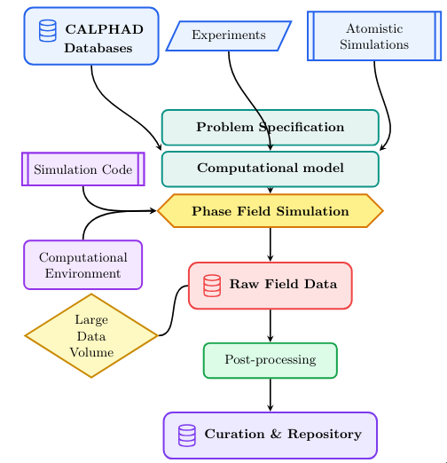

## Overview

* **The Phase-Field Data Challenge**
* **AI Ready Data**
* **A 5-Level Maturity Ladder**
* **Reaching Level 3 (RO-Crate & WRROC)**
* **Defining Level 4 (MatCore-PF)**
* **Summary**

::: {.notes}
* Frame the talk as an interactive 20-minute overview designed to spark open discussion.
* Emphasize that this combines two closely linked efforts: the MaRDA Phase-Field Schema Working Group paper (focused on practical RO-Crate packaging) and the NSF MatCore-PF standard (focused on minimum domain metadata, currently undergoing revision based on community feedback).
:::

---

## Why Phase Field Lags in FAIR Data {.smaller}

:::: {.columns}

::: {.column width="45%"}

**Why Atomistic & DFT Succeeded First:**

* Consolidated around a few standard codes (**LAMMPS**, **GROMACS**, **VASP**)
  and community repositories (**NOMAD**, **Materials Project**, **OQMD**,
  **OPTIMADE**).

**Phase-Field Bottlenecks:**

1. **Input Diversity:** CALPHAD databases, experiments, and atomistic inputs
   making it difficult to record provenance.
2. **Large Binary Data Volumes:** Large VTK / NetCDF / XDMF files strip semantic context.
3. **Custom Codes** with different physics
4. **Absence of Central Infrastructure**

:::

::: {.column width="55%"}


<div style="font-size: 0.55em; text-align: center; margin-top: 8px; line-height: 1.2; color: #666;">
<b>Phase-Field Workflow</b>
</div>
:::

::::

::: {.notes}
* Contrast MD (where a single force field + atomic coordinates define the run) with phase field (where custom PDEs, non-dimensionalizations, and CALPHAD couplings vary wildly).
* Because raw field outputs are huge, researchers typically only share post-processed curves (like Avrami solid fraction on PFHub), discarding the raw field state needed for secondary analysis or ML surrogate training.
:::

---

## Why Schemas Matter in the Era of AI {.smaller}

:::: {.columns}

::: {.column width="50%"}

**The Skeptic's Question:**
*"If LLMs can read arbitrary code and files, why bother with schemas and controlled vocabularies?"*

* **What AI *Does* Replace (Manual Syntax):** Humans should never hand-write 200 lines of JSON-LD or XML. Coding agents can infer and format metadata automatically from scripts and build files.
* **What AI *Cannot* Replace (Unrecorded Ground Truth):** No LLM can inspect a raw binary `.vtk` array and recover unrecorded physical units, boundary conditions, CALPHAD database versions, or whether an interface width was artificially scaled.
* **Preventing Silent Semantic Drift:** In phase-field codes, symbols like $W$, $M$, $\kappa$, and $\epsilon$ carry conflicting meanings and units across groups. Controlled vocabularies prevent AI pipelines from silently mixing incompatible physics.

:::

::: {.column width="50%"}

**Pillar Framework for AI-Ready Data:**

1. **Structure:** Explicit semantics, entity relationships, and ontologies (`RO-Crate` / `OntoMS-PF`).
2. **Acquisition:** Automated capture of prospective and retrospective context at runtime.
3. **Quality:** Checksums, version control (`git` / `SWHID`), and normative unit validation (`Annex U`).
4. **Governance:** FAIR licensing (`SPDX`) and persistent identifiers (`DOI`, `ORCID`, `ROR`).
5. **Analysis & Workflow:** Reproducible execution graphs (`WRROC`) ready for surrogate training (e.g., FNOs) and agentic workflows.

<div style="font-size: 0.6em; margin-top: 15px; padding: 10px; border-left: 4px solid #268bd2; background: rgba(38, 139, 210, 0.08);">
<b>Core Shift:</b> Schemas are no longer bureaucracy written <em>by</em> humans—they are deterministic contracts <em>between</em> AI agents, solvers, and repositories.
</div>

:::

::::

::: {.notes}
* Be candid here: if a schema requires researchers to manually fill out giant web forms, it will fail, and AI *should* kill that workflow.
* However, when training ML surrogates (like Fourier Neural Operators for AM) or letting agentic AI tools orchestrate simulations, probabilistic guessing over unannotated folders leads to silent unit and physics errors.
* Controlled vocabularies + normative units turn an error-prone reverse-engineering guess into a fast, deterministic validation check.
:::

---

## Incremental Progress: 5-Level FAIR Maturity {.smaller}

:::: {.columns}

::: {.column width="45%"}

* **Level 1 (`PDF` — Paper Publication):** Data, workflows, and code described in prose; available only "upon reasonable request."
* **Level 2 (`GIT` — Open Repository):** Code and data uploaded with a permissive license, but reuse still requires author guidance *(current community baseline)*.
* **Level 3 (`JSON` — Machine-Actionable Metadata):** Simulation inputs, execution provenance, and outputs packaged in a structured graph (`RO-Crate` + `WRROC`).
* **Level 4 (`MM` — Minimum Metadata Requirements):** Community-agreed mandatory domain fields and controlled vocabularies (`MatCore-PF`) with FAIR mappings.
* **Level 5 (`VV` — Automated Verification & Validation):** Executable CI/CD pipelines and repositories (`PFHub`) automatically validate metadata completeness and physical consistency.

:::

::: {.column width="55%"}

```{.d2 width="100%"}
direction: up
vars: {
  d2-config: {
    layout-engine: elk
  }
}

l1: "Level 1 [PDF]: Described in a manuscript (available on request)" {
  style: { fill: "#F8FAFC"; stroke: "#94A3B8"; border-radius: 6 }
}
l2: "Level 2 [GIT]: Openly published in a repository with permissive license (Current Norm)" {
  style: { fill: "#F1F5F9"; stroke: "#64748B"; border-radius: 6 }
}
l3: "Level 3 [JSON]: Annotated with machine-actionable metadata (RO-Crate / WRROC)" {
  style: { fill: "#DBEAFE"; stroke: "#2563EB"; stroke-width: 2; border-radius: 6; bold: true }
}
l4: "Level 4 [MM]: Satisfies community minimum metadata requirements (MatCore-PF)" {
  style: { fill: "#BFDBFE"; stroke: "#1D4ED8"; stroke-width: 2; border-radius: 6; bold: true }
}
l5: "Level 5 [VV]: Automated verification & validation in repository / CI/CD" {
  style: { fill: "#1E3A8A"; font-color: "#FFFFFF"; stroke: "#1E3A8A"; border-radius: 6; bold: true }
}

l1 -> l2 -> l3 -> l4 -> l5: "Increasing FAIR Maturity"
```

<div style="font-size: 0.6em; margin-top: 10px; text-align: center; line-height: 1.2; color: #666;">
<b>Incremental Roadmap:</b> Rather than demanding a jump straight to full ontological validation (Level 5), this work defines <b>Level 3</b> (via RO-Crate) and lays the foundation for <b>Level 4</b> (via MatCore-PF).
</div>

:::

::::

::: {.notes}
* Credit Zach Trautt for framing this 5-level maturity staircase.
* You can use either the D2 version above or Zach's compiled TikZ staircase (`images/5-level-maturity-phase-field.svg`).
:::

---

## Six Metadata Categories (`M1`–`M6`) {.smaller}

:::: {.columns}

::: {.column width="42%"}

**Prospective vs. Retrospective Split:**

* **Prospective (Blue):** Knowable *before* execution—problem specification, numerical scheme, software environment. Authored or inferred once and reused.
* **Retrospective (Red):** Capturable only *during/after* execution—timestamps, wall time, memory usage, output file manifests, and checksums. Must be harvested automatically.

**The Critical Gap:**

* Generic standards (`Schema.org`, `DataCite`, `CodeMeta`) already handle **M3–M6** well.
* **M1 (Problem Specification)** and **M2 (Numerical Solution)** have **Low** maturity—no cross-code standard exists for PDE formulations and discretizations.

:::

::: {.column width="58%"}

| Category | Representative Standards | Maturity |
| :--- | :--- | :---: |
| **M1. Problem Specification** | *None broadly adopted*; domain-specific (`MatCore-PF`, `OntoMS-PF`) | **Low** |
| **M2. Numerical Solution** | Limited atomistic support (`NOMAD`); *no PDE standard* (`MatCore-PF`) | **Low** |
| **M3. Comp. Env. & Provenance** | `CodeMeta`, `RO-Crate` (`WRROC`), `W3C PROV`, `FAIR4RS` | **High** |
| **M4. Dataset Characterization** | `RO-Crate`, `DCAT`, `Data Package`, emerging ML schemas | **Mod–High** |
| **M5. Resource Identification** | `Schema.org`, `DataCite`, `Dublin Core`, `MatCore Minimal` | **High** |
| **M6. Funding & Support** | `DataCite`, `Crossref Funder Registry`, `Schema.org` | **High** |

<div style="font-size: 0.6em; margin-top: 12px; text-align: center; color: #666;">
<b>Modular Architecture:</b> Use <code>RO-Crate / WRROC</code> for the high-maturity scaffolding (M3–M6), and plug in <code>MatCore-PF</code> / <code>OntoMS-PF</code> specifically for M1 and M2.
</div>

:::

::::

---

## Workflow Run RO-Crate (`WRROC`) {.smaller}

:::: {.columns}

::: {.column width="44%"}

**Why RO-Crate + WRROC?**

* Packages raw data, scripts, and environment files alongside a single `ro-crate-metadata.json` (`JSON-LD` RDF graph).
* **Process Run Crate Profile:** Ideal for standalone phase-field simulations invoked directly without a heavy workflow engine.
* **Core `CreateAction` Provenance Node:**
  * `instrument` $\rightarrow$ Simulation solver / script
  * `object` $\rightarrow$ Input parameter & config files (`variableMeasured`)
  * `result` $\rightarrow$ Raw field snapshots & derived stats
  * `containerImage` / `softwareRequirements` $\rightarrow$ Reproducible environment (`Nix`, Docker)
  * `resourceUsage` $\rightarrow$ Retrospective runtime telemetry

:::

::: {.column width="56%"}

```{.d2 width="100%"}
direction: right
vars: {
  d2-config: {
    layout-engine: elk
  }
}

classes: {
  prospective: {
    style: {
      fill: "#DBEAFE"
      stroke: "#1D4ED8"
      stroke-width: 2
      border-radius: 6
    }
  }
  retrospective: {
    style: {
      fill: "#FEE2E2"
      stroke: "#DC2626"
      stroke-width: 2
      border-radius: 6
    }
  }
}

prospective_group: Prospective Metadata (Before Run) {
  style.stroke-dash: 3
  env: "Comp. Environment\n(@type: SoftwareApplication)" { class: prospective }
  tool: "Simulation Software\n(@type: SoftwareApplication)" { class: prospective }
  param: "Parameters\n(@type: PropertyValue)" { class: prospective }
  input: "Input Files\n(@type: File / Dataset)" { class: prospective }
  container: "Container / Nix Env\n(@type: ContainerImage)" { class: prospective }

  tool -> env: softwareRequirements
  input -> param: variableMeasured
}

retrospective_group: Retrospective Metadata (During / After Run) {
  style.stroke-dash: 3
  run: "Computational Execution\n(@type: CreateAction #run-1)" {
    class: retrospective
    style.bold: true
  }
  output: "Raw & Derived Data\n(@type: File / Dataset)" { class: retrospective }
  usage: "Runtime Telemetry\n(@type: PropertyValue)" { class: retrospective }

  run -> output: result
  run -> usage: resourceUsage
}

retrospective_group.run -> prospective_group.tool: instrument
retrospective_group.run -> prospective_group.input: object
retrospective_group.run -> prospective_group.container: containerImage
```

<div style="font-size: 0.58em; margin-top: 8px; text-align: center; line-height: 1.2; color: #666;">
<b>Process Run RO-Crate Graph (D2):</b> Prospective entities (blue) are authored or inferred before execution; retrospective entities (red) are harvested automatically upon completion.
</div>

:::

::::

---

## FiPy + PFHub Benchmark 8a: 3 Lines of Python {.smaller}

:::: {.columns}

::: {.column width="54%"}

**Lightweight Wrapper (`fipy_rocrate`):**

```python
import sys, yaml
import fipy as fp
from fipy_rocrate import WROCManager

yamlfile = sys.argv[1]
with open(yamlfile, "r") as f:
    params = yaml.safe_load(f)

# 1. Initialize & start RO-Crate inference engine
wroc = WROCManager(
    run_name="PFHub Benchmark 8a",
    run_description="Homogeneous Nucleation, single seed",
    input_yaml=yamlfile,
    script_path=__file__,
    based_on_url="https://github.com/usnistgov/pfhub/...",
    based_on_id="https://pages.nist.gov/pfhub/benchmarks/benchmark8.ipynb/"
)
wroc.start()

# ... [standard FiPy mesh, equation & solver loop] ...

# 2. Sweep outputs, log runtime & write JSON-LD
wroc.finalize(output_paths=[
    "data/fields",   # indexes transient field snapshots
    "data/stats.txt" # parses column headers into variableMeasured
])
```

:::

::: {.column width="46%"}

**Generated WRROC Directory Tree:**

```text
./ (WRROC Root Directory)
├── params8a.yaml          [Prospective: Parameters]
├── pyproject.toml         [Prospective: Python Env]
├── flake.nix              [Prospective: Deterministic Nix]
├── benchmark8a.py         [Prospective: Instrument]
├── benchmark8-spec.ipynb  [Context: isBasedOn Spec]
├── fields/                [Retrospective: Raw Meshes]
│   ├── phase_field_0.tar.gz
│   └── phase_field_10.tar.gz
├── stats.txt              [Retrospective: Avrami Stats]
└── ro-crate-metadata.json [JSON-LD Provenance Graph]
```

* **Zero Manual JSON-LD:** Inferred directly from `pyproject.toml`, `uv.lock`, `flake.nix`, and `params8a.yaml`.
* **Built with AI Coding Agents:** Writing custom `ro-crate-py` inference glue for an in-house solver is now a 1-afternoon task with LLM assistance.

:::

::::

::: {.notes}
* Emphasize the opening sentence of Section 3: "Three added lines of Python turn an existing FiPy script into a self-describing research object."
* Note that on PFHub today, users only upload `stats.txt` (the derived Avrami curve). Packaging the full RO-Crate on Zenodo preserves the raw `phase_field_*.tar.gz` meshes alongside the exact `flake.nix` environment.
:::

---

## Community Case Studies: Solidification & AM {.smaller}

:::: {.columns}

::: {.column width="33%"}

**1. PRISMS-PF (Post-Run Script)**
*David Montiel & Katsuyo Thornton (UMich)*

* **Application:** 2D directional solidification of an **Al–Cu alloy** (`deal.II` matrix-free FEM, `p4est` AMR, `MPI`).
* **Approach:** `prisms-pf_rocrate` + `mcpf` harvest metadata after execution from `parameters.prm`, `CMakeFiles`, runtime logs, and `.vtk`/`.vtu` snapshots.
* **Repository Link:** Bridges local simulation runs to published **Materials Commons** datasets.

:::

::: {.column width="33%"}

**2. OpenPhase & OPStudio (Native C++)**
*Marvin Tegeler (OpenPhase Solutions)*

* **Application:** 2D Additive Manufacturing simulation of an **Al–Ni alloy**.
* **Approach:** Native `MetaData` C++ class (`OPSettings.Meta.WriteJSON`) integrated directly into the solver core and `OPStudio` GUI.
* **Key Payoff:** Automatically records exact `OPExe` build version, `git` commit hash, start/end timestamps, `.opi` parameters (`#param-dx`), and **SHA-256 checksums** for every output file.

:::

::: {.column width="34%"}

**3. PACE3D + OntoMS-PF (Ontology)**
*Hafiz Noman & Michael Selzer (KIT)*

* **Application:** 2D dendritic solidification in **304L stainless steel** (`Fe–Cr–Ni–C`) under plane-strain shear at 1300 °C.
* **Approach:** Two-step `CreateAction` chain (`SimulationExecution` $\rightarrow$ raw `.p3s` fields $\rightarrow$ `data2vtk.sh` $\rightarrow$ `.vtk`) overlaid with the **OntoMS-PF** OWL ontology, `Metadata4Ing` (`m4i`), and `PMDco`.
* **Key Payoff:** Every parameter and boundary condition resolves to a formal IRI (`#BWUniCluster`).

:::

::::

<div style="font-size: 0.6em; margin-top: 15px; text-align: center; color: #666;">
<b>Takeaway:</b> Whether wrapped externally in Python (`FiPy`, `PRISMS-PF`), compiled natively in C++ (`OpenPhase`), or paired with an OWL ontology (`PACE3D`), <code>WRROC</code> adapts without disrupting existing solver workflows.
</div>

---

## Reaching Level 4: The MatCore Standard {.smaller}

:::: {.columns}

::: {.column width="48%"}

**What is MatCore?**

* An NSF-supported, cross-disciplinary metadata standard for **Computational Materials Science (CMS)** (`matcore.org`).
* **Implementation-Agnostic (`Section 1.3`):** Defines the logical property hierarchy and controlled vocabularies—can be serialized in XML, YAML, or embedded directly inside `RO-Crate` (`JSON-LD`).
* **Modular Inheritance Architecture:**
  * **Minimal MatCore (`Tables Min-1`–`Min-5`):** Universal across all CMS methods.
  * **Method Extensions:** `MatCore-DFT`, `MatCore-MD`, `MatCore-MBPT`, `MatCore-ML`, **`MatCore-PF`**, and `MatCore-DER` (combinable for multiscale workflows).

:::

::: {.column width="52%"}

**Minimal MatCore Highlights (`Table Min-1`):**

* **`creator*` & `contributor*`:** Supports researchers (`ORCID`), institutions (`ROR`), and **AI / software agents** (e.g., `"Claude Opus 5.5"`, Zenodo DOIs, Software Heritage `SWHID`).
* **`material*`:** `constituent*` (species & concentration), `phase*` (`Crystal`, `Liquid`, `Amorphous`, etc.), `microstructure`.
* **`computation*`:**
  * `method-class*` (MODA: `Electronic`, `Atomistic`, `Mesoscopic`, `Continuum`, `Data-driven`)
  * `method*` (`PF`, `MD`, `DFT`, `KMC`, `ML`, etc.)
  * `simulation-conditions*` (`Equilibrium`/`Nonequilibrium`, `temperature`, `stress`, `strain`, `heat-flux`, `temperature-gradient`)
* **`provenance`:** `event-type*`, `agent*`, and file `checksum` (`SHA-256`).

:::

::::

::: {.notes}
* Mention that the MatCore draft went out for community feedback earlier this year and is currently undergoing active revision—so any feedback from CHiMaD XXI today can directly shape the upcoming release!
:::

---

## MatCore-PF Schema Architecture (D2 ERD) {.smaller}

:::: {.columns}

::: {.column width="40%"}

**Filling the `M1` & `M2` Gaps:**

* **`Table PF-1` (Top-Level):**
  * `physical-phenomena*` (Solidification, Sintering, Grain growth, etc.)
  * `problem-specification*` (`M1`)
  * `domain-and-mesh` (`M2`)
  * `numerical-method*` (`M2`)
  * `variables` (`M1` / `M2`)
* **`Tables PF-2`–`PF-7` (Sub-Tables):**
  * Structured sub-objects for governing equations, free-energy functionals, grid spacing, time steps, model parameters, and field variables.
* **`Annex U` (Normative Units):**
  * QUDT dimension vectors + CODATA 2022 factors + `x-gnu:` escape hatch.

:::

::: {.column width="60%"}

```{.d2 width="100%"}
direction: right
vars: {
  d2-config: {
    layout-engine: elk
  }
}

pf1: Table PF-1: MatCore-PF Root {
  shape: sql_table
  style.fill: "#EBF3FE"
  physical-phenomena*: "string[] (Directional solidification, ...)"
  problem-specification*: "SubProperties (M1)"
  domain-and-mesh: "1D/2D/3D, mesh-type, BCs, ICs (M2)"
  numerical-method*: "FDM/FEM/FVM/Spectral, solver (M2)"
  variables: "SubProperties (M1/M2)"
}

pf2: Table PF-2: governing-equation* {
  shape: sql_table
  style.fill: "#E6F4F1"
  type*: "CH | AC | GP | FID | PFC | Coupled"
  evolved-variable*: "string (matches field-variable)"
  driving-energy: "string[] (matches free-energy)"
}

pf3: Table PF-3: free-energy* {
  shape: sql_table
  style.fill: "#E6F4F1"
  name*: "string (e.g. f_chem, f_total)"
  description*: "Calphad | Poly | Regular | Ideal"
  expression: "LaTeX | SymPy | Code snippet"
  unit: "Annex U / GNU unit"
}

pf4_5: Tables PF-4 & PF-5: Discretization {
  shape: sql_table
  style.fill: "#FEF9C3"
  grid-spacing: "{name* (dx, min, max), value*, unit*}"
  time-step-size: "{name* (dt, min, max), value*, unit*}"
}

pf6_7: Tables PF-6 & PF-7: Variables {
  shape: sql_table
  style.fill: "#F3E8FF"
  model-parameter: "{name*, value*, unit*, description}"
  field-variable: "{name*, type* (Scalar/Vector/Tensor), unit*}"
}

pf1.problem-specification* -> pf2
pf1.problem-specification* -> pf3
pf1.numerical-method* -> pf4_5
pf1.variables -> pf6_7
pf2.driving-energy -> pf3.name*: references
pf2.evolved-variable* -> pf6_7.field-variable: evolves
```

<div style="font-size: 0.55em; text-align: center; margin-top: 6px; color: #666;">
<b>D2 Entity-Relationship Diagram (`shape: sql_table`):</b> Illustrates how `Table PF-1` branches into `Tables PF-2` through `PF-7`.
</div>

:::

::::

---

## MatCore-PF in Action: PFHub Benchmark 8a {.smaller}

:::: {.columns}

::: {.column width="48%"}

**Problem Specification (`JSON-LD` in RO-Crate):**

```json
"physical-phenomena": ["Isothermal solidification"],
"problem-specification": {
  "time-dependence": "Transient evolution",
  "governing-equation": [{
    "type": "AC",
    "evolved-variable": "phi",
    "driving-energy": ["f_total"]
  }],
  "free-energy": {
    "name": "f_total",
    "description": "Poly",
    "expression": "0.5*(nabla phi)^2 + phi^2*(1-phi)^2 - delta_f*phi^3*(10-15*phi+6*phi^2)",
    "unit": "dimensionless"
  }
},
"domain-and-mesh": {
  "dimensionality": "2D",
  "coordinate-system": "Cartesian",
  "mesh-type": "Regular",
  "domain-size": [100.0, 100.0],
  "boundary-conditions": ["Periodic"]
}
```

:::

::: {.column width="52%"}

**Numerical Method & Variables (`Tables PF-4`–`PF-7`):**

```json
"numerical-method": [{
  "spatial-discretization": "FVM",
  "spatial-accuracy-order": 2,
  "temporal-discretization": "Implicit",
  "temporal-accuracy-order": 1,
  "grid-spacing": [
    {"name": "dx", "value": 1.0, "unit": "dimensionless"},
    {"name": "dy", "value": 1.0, "unit": "dimensionless"}
  ],
  "time-step-size": [
    {"name": "dt", "value": 0.01, "unit": "dimensionless"}
  ],
  "solver": ["FiPy Default Linear Solver"]
}],
"variables": {
  "model-parameter": [
    {"name": "delta_f", "value": 0.04714, "unit": "dimensionless",
     "description": "Nucleation driving force (sqrt(2)/30)"},
    {"name": "r_0", "value": 5.05, "unit": "dimensionless",
     "description": "Initial diffuse seed radius"}
  ],
  "field-variable": [
    {"name": "phi", "type": "Scalar", "unit": "dimensionless",
     "description": "Non-conserved order parameter (0=liquid, 1=solid)"}
  ]
}
```

:::

::::

<div style="font-size: 0.6em; margin-top: 8px; text-align: center; color: #666;">
<b>Dataset Source:</b> FiPy Implementation of PFHub Benchmark 8a (Homogeneous Nucleation), Zenodo DOI: <a href="https://zenodo.org/records/7319845">10.5281/zenodo.7319845</a>.
</div>

---

## Summary & Open Discussion: Shaping MatCore-PF {.smaller}

:::: {.columns}

::: {.column width="62%"}

**Where We Need CHiMaD Community Input (Next Revision):**

1. **Multi-Term Free Energies & Auxiliary Functions:**
   * Should `free-energy*` (`PF-3`) be `Repeatable: True` to match multiple `driving-energy` entries (`f_chem`, `f_elastic`), and should auxiliary `function` definitions (e.g., $g(\phi)$, $p(\phi)$) be restored alongside `model-parameter`?
2. **Rapid Solidification & AM Couplings:**
   * What fields are essential for far-from-equilibrium solidification, melt-pool fluid flow, or thermal gradient ($G$) / velocity ($R$) handoffs?
3. **Controlled Vocabularies vs. Flexibility:**
   * Where should we enforce strict enums + **Annex U** QUDT units vs. free-form user strings and `x-gnu:` units?
   * *Bonus:* In `Table Min-1` (MODA), should Phase Field sit under `Mesoscopic` or `Continuum`?
4. **PFHub & Recommended Practices Integration:**
   * Can `RO-Crate` + `MatCore-PF` serve as the next-generation submission bundle for PFHub?

:::

::: {.column width="38%"}

<div style="margin-top: 5px; text-align: center;">

**Let's discuss & red-pen the schema!**<br>
daniel.wheeler@nist.gov<br>
[https://matcore.org](https://matcore.org)

<br>

{width="55%" fig-align="center"}

<div style="font-size: 0.65em; margin-top: 10px; line-height: 1.3;">
<b>Scan to view & comment on:</b><br>
• MatCore-PF Tables (PF-1 to PF-7)<br>
• WRROC / RO-Crate Preprint & Examples
</div>

</div>

:::

::::

::: {.notes}
* Leave this slide up during the open discussion.
* Invite people running AM / rapid solidification codes (PRISMS-PF, OpenPhase, PACE3D, MOOSE, AMReX, etc.) to point out what would break or be awkward when mapping their input files into `PF-1` through `PF-7`.
:::

chimad_xxi_matcore_slides.qmd
Displaying chimad_xxi_matcore_slides.qmd.

